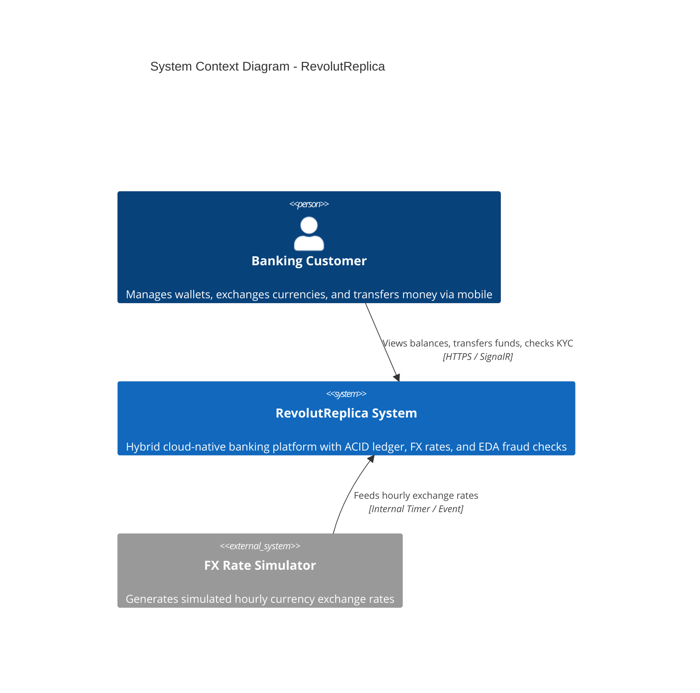
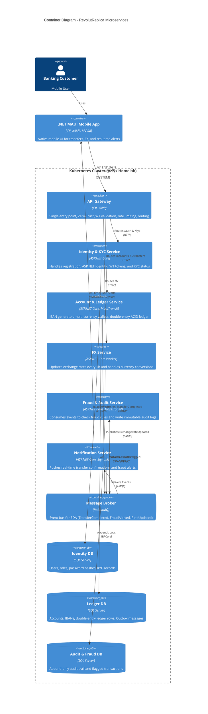
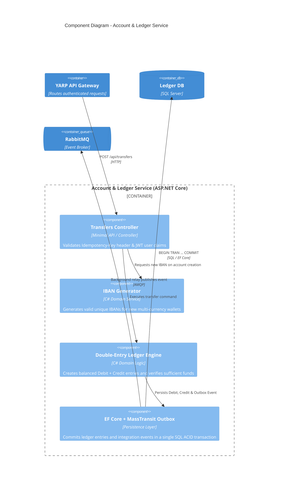

RevolutReplica - Banking System (Hybrid)

This project is based on the banking app Revolut, where such as implementing EDA (Event-Driven Architecture) and minimal frauch detection mechanisms.
The Bank Management System is built using C#, SQL Server, and .NET MAUI native.

The reason I chose .NET MAUI is because of this article:
https://www.c-sharpcorner.com/article/difference-between-net-maui-and-blazor-hybrid-and-when-should-i-use-each?srsltid=AYCX9vJasjCcaTjannDj_blX9Jf1UnQzwBgbquX4nMoVo7QSC23gjnWw

It's very precise about the use cases of the Tech Stack, what I mean by that, is that MAUI more on the performance-critical apps side is.

The colors are from "https://coolors.co/" 1. #5E6973 2. #000000 3. #F1F2F6 and the pop 4. #02C39A 5. #BF1363

Main focus in this project will be the backend such as client transactions, security and logging.

Some features I have in mind:
Deposit & Withdraw
Success and confirmation messages
Transfer funds between two accounts (ACID)
Currency Exchange, also with random value so every 1h it's changing value.
KYC - (Know your customer)
Authentification with JWT (JSON Web Tokens), Passwort over ASP.NET Core Identity
Audit-Logs
IBAN - generator

Tech Stack used in the project:

    Language: C#
    Frontend: .NET MAUI (MVVM)
    Database: SQL Server
    API Gateway: YARP
    Architecture: Microservices
    Message Broker: RabbitMQ
    Saga Pattern: MassTransit
    Orchestration local: .NET Aspire
    Orchestration production-grade: Kubernetes

By avoiding monolithic architecture we ensure, that our application is scalable, has a rapid deployment & iteration anf fault isolation.
Some drawbacks are the complexity, simplicity to set up and monitoring.

https://www.geeksforgeeks.org/software-engineering/monolithic-vs-microservices-architecture/

 - image from nasscom community

Architecture details:

Reason behind C#?

Very simple, I have and I am programming C# it is the best language to choose right now, so I don't have to focus on so many new implementations at once. It was a tactical decision.

Why .NET MAUI and not .NET Blazor or React?
Same as for this, I already have hands on experience with .NET MAUI, also with Blazor but not as much and that is the reason will stick with .NET MAUI.

Database  as SQL Server with SSMS (SQL Server Management Studio)

This has the best compatiblity with C# and is also a very fast and scalable relational Database.
A NoSQL Database just isn't enough for the ACID-charactestics, altough NoSQL points to performance and scalability.

How come YARP (Yet Another Reverse Proxy) as the API Gatway?

It is Open-Source, it has been programmed for the .NET Ecosystem and it is as a NuGet-Package to install. Easy and straightforward.
The second option was Ocelot, but it lacks the compatibility in my point of view.

Compatibility as in:
1. Security (Zero Trust)
2. Auditing & Compliance
3. Small latency, which is crucial for a banking system

I do have to say, the Dashboard will be a hustle, where Ocelot has a plus point. It would be easier in Ocelot to implement these nice to have features.
Nevertheless, exchanging beauty for performance and security should be on number 1 place.

Example of an API-Gateway

 - image from microsoft learn

CI/CD Implementation and Homelab-DevOps dependency and relationship

• The Architecture: A microservices application deployed to Azure.
Core Focus: GitOps, Kubernetes, and automated security.
• Implementation Steps:
1. CI Stage: Set up GitHub Actions to run unit tests, build Docker images, and immediately scan them for vulnerabilities using Trivy.
2. Secret Management: Integrate HashiCorp or Azure Key Vault so secrets are injected dynamically at runtime rather than stored in Git.
3. CD (GitOps) Stage: Set up ArgoCD inside the Kubernetes cluster. Configure it to monitor a separate gitops-manifests repository. When GitHub Actions updates the image tag in the manifests repo, ArgoCD automatically syncs and deploys it.
4. Policy & Monitoring: Implement Kyverno to block non-compliant images and use Prometheus/Grafana to track deployment metrics (deployment frequency, lead time for changes).

Architecture Diagram (Design):
C4 Model

Level 1 - System Context Diagram

Level 2 - Container Diagram

Level 3: Component Diagram

Resources:
Architecture Design:
https://c4model.com/
https://www.visual-paradigm.com/guide/c4-model-case-study-modernizing-internet-banking/
https://c4model.com/abstractions/microservices
https://medium.com/@gauravtiwari9098/c4-modeling-7dd8ae379f73

Microservices Architecture Design:
https://learn.microsoft.com/en-us/dotnet/architecture/microservices/multi-container-microservice-net-applications/microservice-application-design
https://learn.microsoft.com/de-de/dotnet/architecture/cloud-native/introduce-eshoponcontainers-reference-app
https://github.com/dotnet-architecture/eshoponcontainers/wiki/Architecture
https://aspire.dev/architecture/overview/

