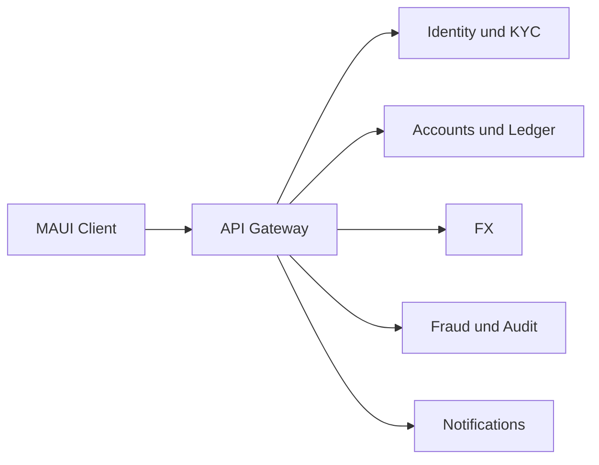

# Architektur und Projektregeln

## Eine Solution, getrennte Anwendungen

`RevolutReplica.sln` ist der gemeinsame Einstieg für Visual Studio. Jedes
ausführbare Projekt bleibt eine eigene Anwendung mit eigenem Prozess und eigener
Konfiguration. Eine gemeinsame Solution bedeutet keine gemeinsame Bereitstellung.



Das Diagramm zeigt die vorgesehenen Kommunikationsgrenzen. Die Routen und
Service-Aufrufe sind noch nicht implementiert. RabbitMQ wird bei der Umsetzung
der Ereignisse ergänzt. Jeder Service besitzt seine eigene SQL-Datenbank.

## Zuständigkeiten

| Projekt | Verantwortung |
| --- | --- |
| `RevolutReplica.Client` | Native MAUI-Oberfläche und Navigation; künftig MVVM und API-Clients |
| `RevolutReplica.Gateway` | Künftig Routing, Zugangsprüfung und Rate Limiting mit YARP |
| `RevolutReplica.Identity.Api` | Künftig Benutzer, Authentifizierung, Rollen und KYC |
| `RevolutReplica.Accounts.Api` | Künftig Konten, IBAN, Ledger und atomare Transfers |
| `RevolutReplica.Fx.Api` | Künftig simulierte Wechselkurse und Währungsumrechnung |
| `RevolutReplica.FraudAudit.Api` | Künftig Fraud-Regeln und unveränderliche Audit-Einträge |
| `RevolutReplica.Notifications.Api` | Künftig Benachrichtigungen und SignalR |

## MAUI: MVVM

Der Client liegt unter `src/Clients/RevolutReplica.Client/`. Sein Namespace beginnt
mit `RevolutReplica.Client`. Der Ordner `Views` enthält bereits die bisherige
`MainPage`; die weiteren MVVM-Ordner sind für neue Klassen vorbereitet.

| Ort | Inhalt | Beispiel für eine spätere Klasse |
| --- | --- | --- |
| `Views/` | XAML, Darstellung und UI-spezifischer Code | `AccountsPage.xaml` |
| `ViewModels/` | Seitenzustand, Commands und Anzeigevalidierung | `AccountsViewModel.cs` |
| `Models/` | Modelle für die Darstellung | `AccountSummary.cs` |
| `Services/` | HTTP-Clients, sichere lokale Speicherung, Geräteschnittstellen | `AccountsApiClient.cs` |
| `Resources/` | Styles, Farben, Bilder und Fonts | `Styles/Colors.xaml` |
| `Platforms/` | Ausschließlich plattformspezifischer Code | Windows-App-Einstieg |
| `MauiProgram.cs` | Registrierung der Abhängigkeiten und App-Konfiguration | ViewModel-/Service-Registrierung |

Die bestehende Zählerseite bleibt eine Vorlage; ihre Umstellung auf MVVM erfolgt
mit der ersten echten UI-Funktion. Im Client werden weder Datenbankzugriffe noch
verbindliche Buchungs- oder Berechtigungsregeln implementiert.

Für die spätere UI ist die Palette `#5E6973`, `#000000`, `#F1F2F6`,
`#02C39A`, `#BF1363` vorgesehen; Erfolg und Warnungen nutzen konventionelle Grün-/Rottöne.

## Services: Fachlogik vom Transport trennen

Jeder Service startet mit einem API-Projekt. Darin sind vier Ordner in Visual
Studio vorbereitet. Noch leere Ordner sind mit `<Folder Include="..." />` im
Projekt hinterlegt; es gibt dafür keine künstlichen Beispielklassen.

```text
RevolutReplica.Accounts.Api/
  Domain/                # Entitäten, Value Objects und fachliche Regeln
  Application/           # Anwendungsfälle, Commands/Queries und Schnittstellen
  Infrastructure/        # Datenzugriff, EF-Migrationen und Messaging-Adapter
  Endpoints/             # HTTP-Routen, Request-/Response-Abbildung
  Properties/            # Lokale Startkonfiguration
  Program.cs             # Dependency Injection und Host-Konfiguration
  appsettings.json
```

`Application` verwendet `Domain`. `Infrastructure` implementiert die in
`Application` benötigten Schnittstellen und darf `Domain` verwenden. `Endpoints`
ruft die Anwendungsfälle auf; `Program.cs` verdrahtet die Implementierungen.
Die Fachlogik kennt weder HTTP noch EF Core, RabbitMQ oder MAUI.

Diese Abhängigkeiten sind derzeit eine Konvention innerhalb eines Projekts. Sobald
ein Service mehr Fachlogik enthält, können `Domain`, `Application` und
`Infrastructure` in eigene Class Libraries extrahiert werden. Dann lassen sich
die Grenzen zusätzlich durch Projektreferenzen und Architekturtests absichern.

Innerhalb der Schichten bei Bedarf nach Anwendungsfällen gruppieren, etwa
`Application/Transfers/` und `Endpoints/Transfers/`. Allgemeine Sammelordner wie
`Helpers` oder `Managers` vermeiden; Namen sollen die konkrete Aufgabe beschreiben.

## Grenzen zwischen den Services

- Der Client und das Gateway referenzieren keine Service-Implementierungsprojekte.
- Services kommunizieren über APIs und später über versionierte Ereignisse.
  Ein Service referenziert nicht das API-Projekt eines anderen Services.
- Jeder Service besitzt seine Datenbank und Migrationen. Keine gemeinsamen
  EF-Entitäten, direkten Schreibzugriffe oder Abfragen über fremde Datenbanken.
- Transportverträge bei ihrer Einführung explizit versionieren. Nur tatsächlich
  benötigte Verträge teilen; keine gemeinsame Bibliothek mit sämtlichen Fachklassen.
- Technische Bausteine erst extrahieren, wenn mehrere Projekte sie wirklich
  benötigen. Die entfernten `BuildingBlocks`-Referenzen bleiben entfernt.

## Fachliche Regeln für kommende Banking-Funktionen

- Accounts und Ledger bilden gemeinsam eine Transaktionsgrenze. Ein Saldo darf
  nicht unabhängig von ausgeglichenen, append-only Ledger-Buchungen verändert werden.
- Ein P2P-Transfer speichert Soll, Haben, das dauerhafte Idempotenz-Ergebnis und
  den Outbox-Eintrag in derselben SQL-Transaktion.
- `Idempotency-Key` mit Datenbank-Eindeutigkeit, Abgleich des Request-Inhalts und
  sicheren Wiederholungen unter Nebenläufigkeit absichern.
- Beträge mit festgelegter Präzision modellieren, etwa als ganzzahlige Centbeträge
  oder passend skaliertes `decimal`. Die Währung gehört zum Wert.
- Ereignisse später mit MassTransit, RabbitMQ und transaktionaler Outbox
  veröffentlichen. Consumer müssen doppelte Zustellung vertragen.
- Sagas koordinieren verteilte Abläufe; sie ersetzen nicht die ACID-Transaktion
  innerhalb des Ledgers.
- JWTs am Gateway und in geschützten Services prüfen. Der zuständige Service
  prüft zusätzlich den Zugriff auf das konkrete Konto.
- Asynchrone Fraud-Prüfungen können bereits verbuchte Transfers erkennen, aber
  nicht rückwirkend verhindern. Audit-Einträge werden nur ergänzt.

## Dokumentationsstand

Dieses Dokument beschreibt die aktuelle Zielstruktur. `Preparation.md` enthält
die ursprüngliche Planung; `PreparationChatGpt.md` ist ein historischer Vorschlag
für einen modularen Monolithen. Die bestehenden draw.io-Diagramme sind Entwürfe
und kein Nachweis bereits implementierter Komponenten.
